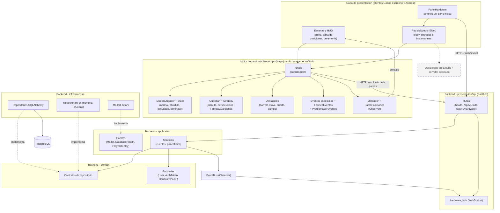

# Vista lógica — Sprint 3

Actualiza la vista del Sprint 2 con el **motor de partida** (cliente Godot, ejecutado por el anfitrión) y el
backend con sus rutas de panel físico. Las líneas punteadas son del roadmap (Sprint 4 en adelante).

**Reglas de dependencia**

- Backend: `presentation → application → domain`; `infrastructure` implementa las interfaces. El dominio no importa FastAPI ni SQLAlchemy.
- Cliente: las escenas dependen del motor y nunca al revés. El motor no usa nodos de Godot, solo `RefCounted` y señales, por eso se prueba sin abrir el juego.
