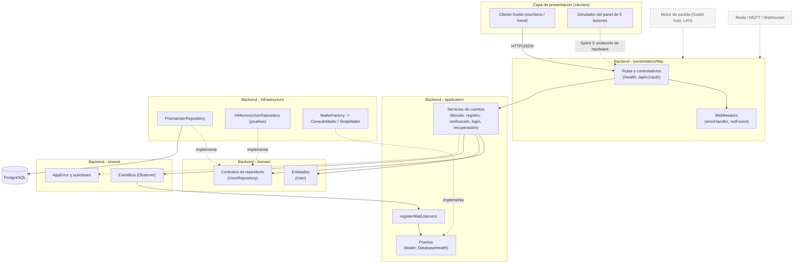

# Vista lógica — Sprint 2

Actualiza la vista lógica de la ERS (sección 7.1) con lo que realmente se construye en el Sprint 2:
el backend de cuentas organizado en capas. Los elementos con línea punteada son del roadmap (Sprint 3 en adelante).

**Regla de dependencia:** `presentation → application → domain`; `infrastructure` implementa las interfaces de `domain` y `application`.
`domain` no importa Express ni Prisma.
