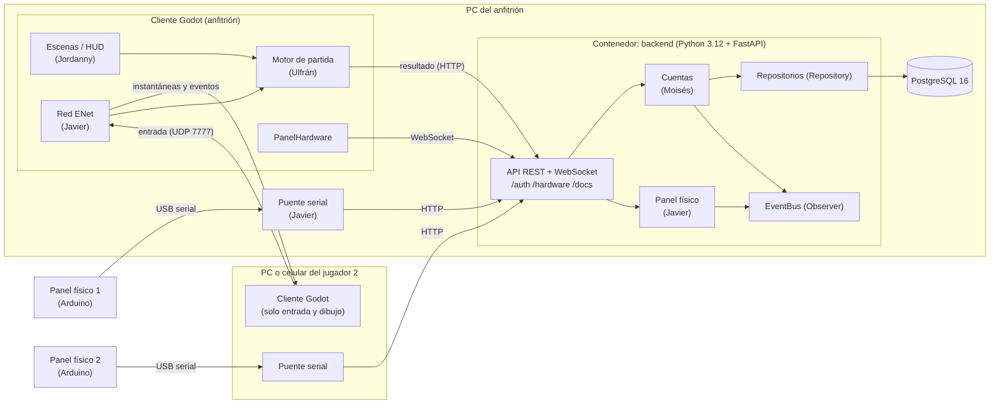

# Diagrama de componentes — Sprint 3

| Componente | Responsable | Estado Sprint 3 |
|---|---|---|
| Motor de partida (estados, guardianes, obstáculos, eventos, puntuación, fin) | Ulfrán | Implementado y con pruebas |
| Arena, escenarios, HUD y ceremonia | Jordanny | Por integrar con el motor |
| Red del juego, panel dentro de la partida, reactor, terminales | Javier | Por integrar con el motor |
| Resultados, ranking, historial, logros | Moisés | Por recibir el `ResultadoPartida` |
| API REST, errores, EventBus, repositorios | Ulfrán | Estable desde el Sprint 2 |
