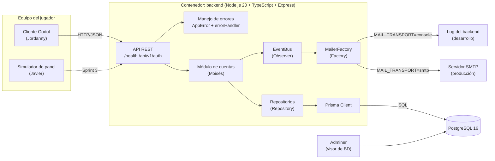

# Diagrama de componentes — Sprint 2

| Componente | Responsable | Estado Sprint 2 |
|------------|-------------|-----------------|
| API REST, errores, EventBus, MailerFactory, repositorios | Ulfrán | Esqueleto listo |
| Módulo de cuentas (servicios de registro, verificación, login, recuperación) | Moisés | En desarrollo |
| Cliente Godot | Jordanny | En desarrollo |
| Simulador de panel y protocolo de hardware | Javier | En desarrollo |
