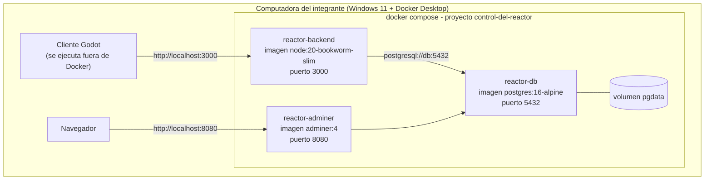

# Vista de despliegue — Sprint 2

Versión local con Docker Compose. La versión cloud con balanceador, Redis y registro de contenedores
de la ERS (sección 7.2) queda para el Sprint 3 (ver ADR-007).

**Arranque:** `docker compose up --build`. El backend espera a que PostgreSQL esté saludable (`pg_isready`),
aplica las migraciones (`prisma migrate deploy`) y recién entonces inicia.

| Servicio | Imagen | Puerto | Healthcheck |
|----------|--------|--------|-------------|
| db | postgres:16-alpine | 5432 | `pg_isready` |
| backend | build de `./backend` (multi-stage) | 3000 | `GET /health` |
| adminer | adminer:4 | 8080 | — |
