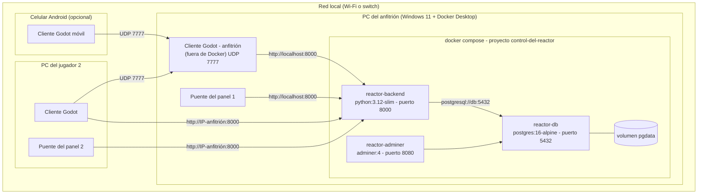

# Vista de despliegue — Sprint 3

Demostración local con Docker Compose y partida en red de área local (ADR-009). La versión cloud con balanceador,
Redis y registro de contenedores de la ERS (sección 7.2) sigue para el Sprint 5 (ADR-007).

**Arranque de la demo**

1. En la PC del anfitrión: `docker compose up --build` y abrir el puerto UDP 7777 en el firewall de Windows.
2. Cada jugador conecta su panel y ejecuta su puente apuntando a la IP del anfitrión (según `hardware/README.md`).
3. El anfitrión crea la partida desde «Jugar»; los demás se unen por IP o código.
4. Al terminar, el anfitrión envía el resultado al backend y se actualiza el ranking.

| Servicio | Imagen | Puerto | Healthcheck |
|---|---|---|---|
| db | postgres:16-alpine | 5432 | `pg_isready` |
| backend | build de `./backend` (multi-stage) | 8000 | `GET /health` |
| adminer | adminer:4 | 8080 | — |
| Partida (Godot anfitrión) | no corre en Docker | UDP 7777 | — |
